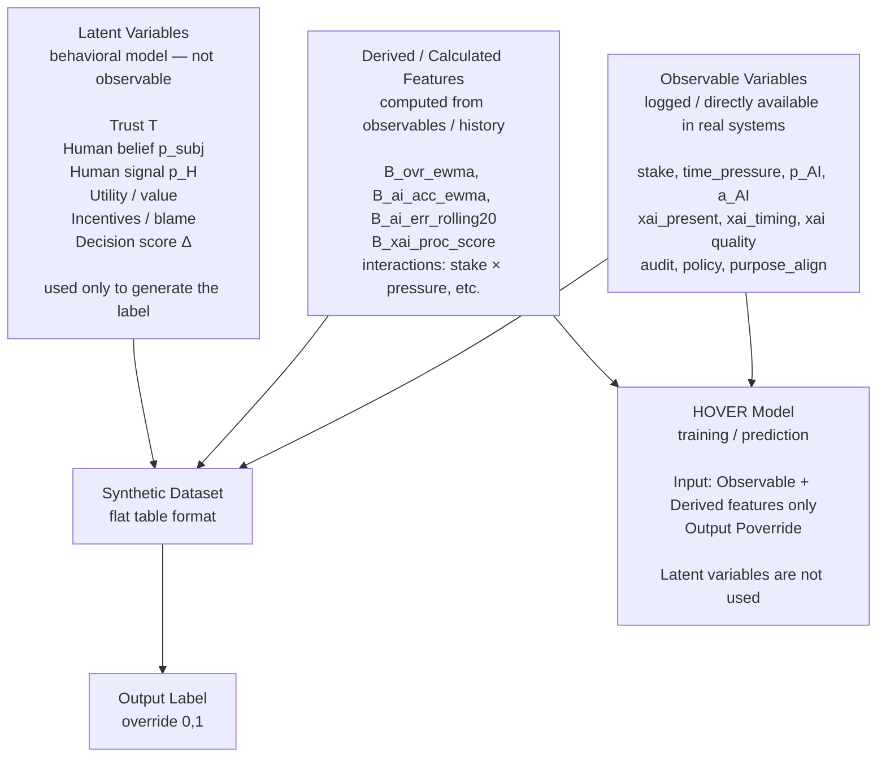

# Modeling Human Behavior in Human-in-the-Loop Systems Using Knowledge-Based Synthetic Data
**Can latent human signals (e.g., trust, bias, risk) be embedded or derived from real-world data?**

--- 
## Content Overview
1- Introduction: Why Human Behavior Should Be Modeled in Human-in-the-Loop Systems

2-Why Directly Learning Human Signals from Real Data Is Problematic

3-Knowledge-Based Synthesis: Building Synthetic Data from Validated Science

4-Modeling the Behavioral Agents: From Literature to Latent Constructs

5-Trust as a Latent Variable: Observable and Derived Features

6- Designing Multiple Synthetic Worlds to Test Behavioral Regimes

7 - Isolating Behavioral Effects: Studying Operator Behavior in HITL Systems

8- Current Stage: Override Prediction model

9- Absolute vs. Relative Feedback Correction

10- The Question: Why are we including humans in the loop at the first place?

11- Freezing Risk’s Impact: Isolating Variables for Study

12- Mechanical vs. Complex Variables: What Can We Adjust Directly?

13- Future Directions: Extending the Framework

14- Key Takeaways

---
## Introduction: Why Human Behavior Should Be Modeled in Human-in-the-Loop Systems
**Latent signals in operational decision traces**
- Decision traces encode behavior : Repeated choices in corporate and clinical logs often preserve stable patterns that can indicate trust, bias, or systematic error tendencies.
- HITL depends on assumptions : Human-in-the-loop design implicitly assumes how people interpret recommendations,can we vary these interpretations by modeling these hidden signals?
- The objective : Not limited to forecasting the next decision, but also explaining quantitively why human defer on AI output.
---
This presentation explores whether latent behavioral constructs—such as trust, bias, and perceived risk—can be represented in decision-making systems when only partial, observable data (e.g., logs, decisions) is available. We propose **knowledge-based synthesis** to create synthetic behavioral worlds grounded in validated scientific findings, focusing on Human-in-the-Loop (HITL) systems.

---

## The Core Challenge
If we assume that the human signals  ( whether behaviors, bias or basic mistakes) is affecting the decision making. 
Then the decision history itself can show these insights. Although they exists, no real-world data has quantitative mesures for human behaviors like trust and belief systems etc.. That’s why we consider them latent, and if we assume 
 A- they exists
 B- we can’t observe them
 C- we can model them
Then we are dealing with Black-box models.

**Why Directly Learning Human Signals from Real Data Is Problematic**
Methodological risks:
- • Latent variables (e.g., trust, belief, risk) are not observable but known to exist.

- Behavior is qualitative: Trust, belief, and risk are context-sensitive constructs that require imperfect proxies, careful operationalization, and strong modeling judgment.
- Bias can be self-sealing:  Extracting knowledge from such data is an attempt to re-establish this black-box, risks **confirmation bias**: designing features based on assumptions rather than ground truth.

- **Solution**: Use **Knowledge synthetic data** built from validated scientific models (e.g., behavioral, cognitive, and institutional psychology).

---

## Knowledge-Based Synthesis
**How do we create synthetic behavioral worlds?**

1. **Extract validated facts** from literature:
   - Behavioral science (e.g., trust models).
   - Cognitive science (e.g., belief updating).
   - Institutional psychology (e.g., risk/utility frameworks).
2. **Define a space or a "world"** committed to these inputs (e.g., distributions, probabilistic models).
3. **Mask latent inputs** (e.g., trust, belief) and retain only **observable data** (e.g., decision logs, AI recommendations).
4. **Result**: A synthetic dataset where latent variables are *known to exist* but not directly observable.

---

## Probabilistic Modeling
**Data as distributions, not fixed variables**

- Features are engineered via **assumptions, distributions, and probabilistic models**.
- **Risk**: Simulating "what we think is real" may only confirm existing knowledge.
- **Solution**: Create **multiple worlds** with varying agent influences to test robustness.

---
## For this presentation i’ll focused on the trust agent and model. 
** how do we model teust in Human_AI collaboration?**

- **See & Lee (2004)**:uses Human-to-Human trust definitions and findings to create an anological model for Human trust in automation:`Trust = f(process, purpose, performance)`.  
- **Forward Updating Bias**:
  - Trust **drops sharply** when humans observe AI mistakes.
  - Trust **increases slightly** when AI is correct.

--- 
## Trust components
** Deconstructing Trust
Three Pillars of Trust (according to See & Lee):
- performance : Expensive to evaluate 
  - based on actual results 
- Process : 
   - transparency 
  - Predictability 
  - How the system operates 
- Purpose : 
   - Alignment with user's goals 
   - Perceived intent of the system
--- 
## Mapping Trust to Observable and Derived Features
**From theory to data**
_ ** The mapping to our existing features** 
 - Performance → AI accuracy, error rates
 - Process → Explanation quality, timing, presence
 - Purpose → Policy alignment, audit presence
By measuring these observable factors, we can quantify the latent concepts of trsut. 

--- 

## Data Pipeline Overview

---

## World Simulation Design
** Concept ** : 
- we have a set of worlds W (simulation of cases)
- Each world represents a different scenario
**How do we ensure robustness? Comparative simulation design**
- ** Problem ** : Single-world design may lead to overfitting to specific assumptions, limiting generalizability.
- **solution**: Create multiple synthetic worlds with varying agent influences to test the model's robustness across different behavioral regimes.

--- 

1. **Baseline World**: All agents (trust, bias, utility) influence decisions equally.
   - This setting distributes influence across agents and serves as a neutral reference for measuring behavioral deviation.
2. **B-Dominant World**: Decisions are primarily driven by **beliefs and biases**.
   - Here, prior expectations and cognitive bias dominate the response pattern, amplifying interpretation effects.
3. **U-Dominant World**: Decisions are driven by **utility** (not necessarily rational).

- **Validation**: An agent is well-embedded in a world throught the designed model if the pattern stands in different worlds
- What this means: 
   - The model should generalize across scenraios 
   - Patterns should be consistent across different world simulations 
   - Cross-world validation across multiple contexts.
---

## Isolating Behavioral Effects
**Studying operator behavior in HITL systems**

- **Goal**: Isolate how **operator behavior** (not operational cases) impacts override/overreliance.
- **Method**:
  - Freeze logs (same input data across worlds).
  - Vary only **behavioral agents** (e.g., trust dynamics, utility sensitivity).
- **Future Work**: Vary both behavioral regimes **and** observable input distributions to test stability under **distribution-shifted conditions**.

---

## Current Stage: Override Prediction model
**What do we already have?**

- **Model Objective**: Predict whether an override will occur.
- **Long-Term Goal**: Correct tendencies in **both** human behavior and AI recommendations.
- **Current Limitation**: Skewed perspective (override = bad, acceptance = good).
- **Next Step**: Use a **confusion matrix** to model override states (not just occurrence).

---

## Absolute vs. Relative Feedback Correction
**How should we correct human/AI tendencies?**

| **Absolute Correction**               | **Relative Correction**               |
|---------------------------------------|---------------------------------------|
| Optimize to reduce **all mistakes** (override/overreliance). | Preserve **human uniqueness** while improving outcomes. |
| **Risk**: Turns HITL into an **AI-AI loop** (AI manipulates humans to follow its recommendations). | **Goal**: Balance AI optimization with human autonomy. |

---

## The Question
**Why are we including humans in the loop at the first place?**

- **Accountability**: Humans and AI both make mistakes; someone must be responsible.
- **Context**: AI lacks full context; humans provide **unquantifiable insights** (e.g., ethical judgments, intuition).
- **Limitation**: We cannot yet model human decisions fully because **we don’t fully understand them**.

---

## Freezing Risk’s Impact
**Isolating variables for study**

- **Example**: Freeze the impact of **risk on override** (make `P(override | risk)` constant).
- **Current Assumption**: Latent variables (e.g., trust, risk) are **independent**.
- **Next Step**: Drop the independence assumption to study **interactions** between variables (e.g., how risk affects trust).

---

## Mechanical vs. Complex Variables
**What can we adjust directly?**

- **Mechanical Variables**: Straightforward to adjust (e.g., AI accuracy, explanation quality).
- **Complex Variables**: Require deeper modeling (e.g., trust, bias, risk tolerance).
- **Current Focus**: Treat latent variables as independent → **Future**: Model interdependencies.

---

## Future Directions
**How will we extend the framework?**

1. Vary **both** behavioral regimes and observable input distributions.
2. Test decision behavior under:
   - **Controlled conditions** (stable environments).
   - **Distribution-shifted conditions** (e.g., new operational contexts).
3. Explore **interactions** between latent variables (e.g., risk → trust → override).

---

## Key Takeaways
**Summary of the presentation**

- Synthetic data + probabilistic modeling can **embed latent human signals** in decision-making systems.
- **Validation**: Multiple worlds ensure the model captures **defined realities**.
- **Goal**: Correct human/AI tendencies **without removing human uniqueness**.
- **Critical Consideration**: How to balance **AI optimization** with **human autonomy**?

---

